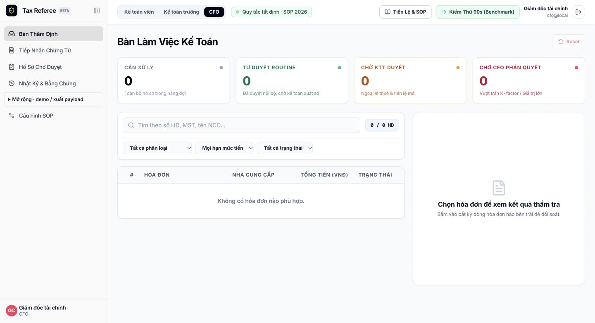

# Khôi phục giao diện trước redesign

Ngày 11/10/2026, người dùng yêu cầu trả lại giao diện trước lần cải tiến UI. Đã khôi phục trên mã nguồn local và [Hostinger live](https://limegreen-salamander-517622.hostingersite.com).

- Nguồn khôi phục: bundle `tax-referee-mvp-role.tgz`, trùng SHA-256 các file kiểm tra với release `codex-20261010-r6` trên host. Đây là bản trước redesign, đã có đăng nhập chọn role.
- Khôi phục 34 file component/style/layout/Verify/SOP/tailwind nguyên vẹn từ bundle. Trang chủ dùng đúng nội dung và bố cục cũ, chỉ giữ server wrapper dynamic chống cache cũ và callback logout ổn định.
- Gỡ các component workspace và helper riêng của redesign không còn được dùng. Lưu bản sao trước khôi phục tại `/tmp/tax-referee-ui-before-revert-20261011.tgz`; release r9 vẫn được giữ trên host.
- Không thay đổi API, rule engine, database hoặc artifacts. Giữ đăng nhập chọn Kế toán viên/Kế toán trưởng/CFO. Không reset dữ liệu nội bộ.
- Release đang chạy: `codex-20261011-r10-ui-restore`. Đổi symlink current atomically rồi restart Passenger; config/runtime vẫn nằm ngoài release.
- Bundle: 1.754.303 byte, SHA-256 `e69be7099d25e961068ec5e28a79a396442c42e3ed79fc9d82d64af143464e35`; đủ compiled routes, không đưa native module macOS hoặc secret vào release.

## Kiểm tra

- Typecheck và build production: PASS.
- API live: PASS demo isolation, routine voucher, pause, stale revision 409, undo, nguồn text, Verify 4/5/15 và input không chắc chắn.
- Browser live: xác nhận sidebar, header chọn role, bốn thẻ thống kê và bố cục bàn thẩm định cũ; session CFO được giữ sau cập nhật.
- Root `/`: HTTP 200, `Cache-Control: no-store, max-age=0`.
- Dữ liệu nội bộ trước/sau: 0 hóa đơn và 9 audit events, không thay đổi trong quá trình khôi phục.
- Không lặp lại toàn bộ nghiệm thu nghiệp vụ vì backend được giữ nguyên; đây là khôi phục giao diện đã có bằng chứng kiểm thử trước đó.

Ảnh và log: [bằng chứng khôi phục](../docs/evidence/ui-restore-2026-10-11/).

