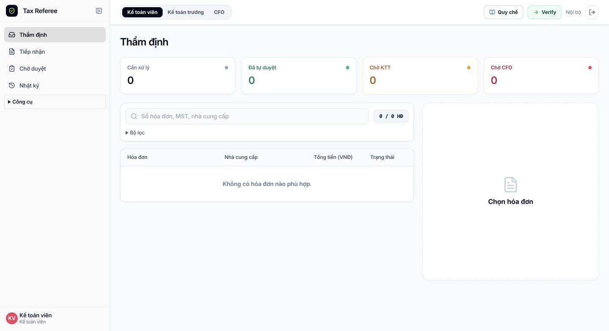

# Tinh gọn giao diện hiện tại

Ngày 11/10/2026. Giữ phong cách và bố cục bản r6 mà người dùng lựa chọn: sidebar, header chọn role, bốn thẻ thống kê và bàn thẩm định hai cột. Tinh gọn trực tiếp trên các component hiện có.

## Đã thay đổi

- Menu: Thẩm định / Tiếp nhận / Chờ duyệt / Nhật ký. Công cụ phụ nằm trong mục Công cụ; giữ các tính năng và nhãn dữ liệu demo / ERP payload.
- Header: Quy chế / Verify / Nội bộ hoặc Demo riêng / Đăng xuất. Bỏ badge Beta, nhãn engine, email/tên lặp lại và mục cấu hình SOP trùng với nút Quy chế.
- Bốn thẻ: Cần xử lý / Đã tự duyệt / Chờ KTT / Chờ CFO. Bỏ mô tả dưới số liệu, giảm độ đậm và bỏ chữ in hoa diện rộng.
- Bảng: tìm kiếm luôn hiện; bộ lọc nâng cao thu gọn, có nhãn Đang áp dụng. Bỏ cột checkbox không sử dụng. Dòng hóa đơn có accessible name và mở được bằng Enter/Space; trạng thái dùng chữ thường dễ đọc.
- Hồ sơ: giữ câu hỏi nghiệp vụ, findings, các phương án và điều kiện duyệt. Chi tiết thường quy và giữ thuế tạm thời chuyển vào disclosure. Bỏ phần căn cứ pháp lý hardcode trong thẻ kết quả; nguyên dữ liệu đánh giá vẫn đọc được.
- Tiếp nhận: tiêu đề và nhãn ngắn hơn, giữ khu vực nguồn và form đối chiếu. Bỏ robot nổi và khung lời thoại trang trí; thông báo của nó chuyển vào disclosure trong form, mở khi lỗi.
- Trang đăng nhập: bỏ hướng dẫn trùng, giữ demo, Verify, chọn role MVP và thông tin tách dữ liệu.
- Reset chỉ hiện trong phiên demo, nhãn Xóa dữ liệu demo. Không thay đổi API/schema/rule engine hoặc quyền xử lý.

## Kiểm chứng và triển khai

- Build production và TypeScript: PASS. `git diff --check`: PASS.
- Browser local: lọc Vượt thẩm quyền cho đúng một hồ sơ; bỏ lọc trả danh sách; Enter mở hồ sơ và hiện chi tiết đánh giá. Gửi input chưa đủ thông tin trong database thử riêng chuyển sang xác minh, không tự duyệt.
- Browser live desktop 1440px: giữ bố cục cũ, nhãn đã rút gọn; phiên nội bộ không còn Reset.
- Browser live 375px: workspace và tiếp nhận không tràn toàn trang (scrollWidth 370px). Không còn robot nổi. Đã reset viewport về kích thước bình thường.
- API smoke live: PASS demo isolation, routine voucher, pause, stale 409, undo, nguồn text, Verify 4/5/15 và input không chắc chắn. Không lặp toàn bộ acceptance vì backend được giữ nguyên.
- Release: `codex-20261011-r11-ui-simple`; giữ `r10-ui-restore` để rollback. Runtime/config nằm ngoài release. Dữ liệu nội bộ trước/sau vẫn 0 invoices, 16 audit events.
- Bundle SHA-256: `4ca88738e855a25ffe183247b3497f76747610185c3917ec8f8ab8c8643db313` (1.744.375 byte).

[Ảnh và log kiểm chứng](../docs/evidence/ui-simple-2026-10-11/).

