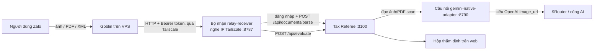

# Nối chatbot Zalo (Goblin) vào Tax Referee

Tài liệu bàn giao cho người sau (kể cả chính người đã dựng). Ngày dựng và đo: 17/10/2026. Mọi con số "đo" bên dưới là kết quả chạy thật hôm đó, không phải ước lượng.

## 1. Mục tiêu và kết quả

Ai nhắn một ảnh, PDF hoặc XML hóa đơn cho chatbot **Goblin** trên Zalo thì hóa đơn tự vào **hộp thẩm định** của Tax Referee, bot trả lời ngay số hóa đơn, bên bán, tổng tiền; kế toán xử lý tiếp trên web như mọi ca khác.

Đã chạy được trọn vòng Zalo → bot → Tailscale → máy chạy tax. Đo: 11/11 file mẫu trong `input-sample/` đọc đúng; XML mất 0–2 giây, PDF khoảng 11 giây, ảnh 8–12 giây.

## 2. Kiến trúc

| Thành phần | Chạy ở đâu | Vai trò |
|---|---|---|
| Goblin (bot Zalo) | VPS, repo riêng (chưa công khai) | Nhận file từ Zalo, tự chuyển sang tax qua `RelayClient`, trả tóm tắt cho người gửi |
| `relay-receiver.mjs` | Máy chạy tax | Nhận file (kiểm token, giới hạn 15 MB, kiểm sha256 toàn vẹn, không lưu thêm bản file trùng), đưa vào tax như người dùng thật rồi đẩy tiếp vào thẩm định |
| `gemini-native-adapter.mjs` | Máy chạy tax, chỉ nghe 127.0.0.1 | Dịch lời gọi model kiểu Google sang kiểu OpenAI để 9Router đọc đúng ảnh |
| Tax Referee | Máy chạy tax | Đọc, thẩm định, hiển thị. **Không sửa logic thẩm định** |
| Tailscale | Cả VPS và máy chạy tax | Đường riêng giữa hai máy; không mở cổng ra internet |

## 3. Những gì đã làm (PR này)

**Trong tax (mã ứng dụng):**
1. `components/workspace/useWorkspaceData.ts`: web tự cập nhật. Cứ 4 giây (chỉ khi tab đang hiện) hỏi `/api/inbox`, chỉ khi danh sách đổi mới tải lại, tải ngầm để không nháy màn hình và không làm trang chi tiết đang mở bị tải lại. Lý do: hóa đơn do bot gửi không đi qua trang web nên trang không biết có ca mới.
2. `app/api/invoices/reset/route.ts` và `components/ProductionWorkspace.tsx`: nút "Xóa hết hóa đơn" (đã có từ PR #15 cho phiên demo) có thể mở cho workspace nội bộ bằng công tắc `TAX_REFEREE_ALLOW_WORKSPACE_RESET=1` (phía máy chủ) và `NEXT_PUBLIC_ALLOW_WORKSPACE_RESET=1` (hiện nút). **Mặc định tắt**; chỉ đặt trong `.env.local` của máy demo, không đặt trên production. Nhật ký audit ghi thêm `mode: workspace`. Lý do: bộ nhận đăng nhập tài khoản nội bộ nên hóa đơn nằm ở workspace nội bộ, nơi nút cũ không hiện, trong khi lúc thử cần dọn danh sách.
3. `tests/unit/workspaceReset.test.ts`: 3 test (mặc định từ chối 403 và không xóa gì; bật công tắc thì xóa và ghi nhật ký; sandbox demo luôn được phép).

**Bộ nối (`integrations/goblin-relay/`):** xem `README.md` trong thư mục đó. Đây là bản chụp ngày 17/10 của các script viết cùng repo Goblin; repo Goblin chưa có remote nên chép vào đây để người khác dựng lại được.

## 4. Quyết định và lý do (đừng đảo ngược khi chưa đọc)

- **Phải có cầu nối đọc ảnh.** Đo 17/10: tax gọi model theo kiểu Google native, 9Router nhận lời gọi nhưng **làm rơi ảnh** (`inlineData`); model không thấy ảnh nên bịa ra một hóa đơn khác mỗi lần (ảnh VinCommerce bị đọc thành Circle K, Gong Cha, LOTTE Mart) mà không báo lỗi nào. Đường OpenAI (`image_url`) đọc đúng. Cầu nối chuyển sang đường đó. Nếu dùng khóa Gemini trực tiếp của Google thì không cần cầu nối.
- **Bộ nhận đăng nhập tài khoản nội bộ** (`TAX_AUTH=password`) để hóa đơn hiện trong hộp thẩm định của đúng tài khoản kế toán. Phiên demo (`TAX_AUTH=demo`) có workspace riêng nên web đang mở sẽ không thấy hóa đơn.
- **Bộ nhận chỉ nghe IP Tailscale**, không bao giờ `0.0.0.0`; token Bearer dài, so sánh thời gian cố định; tường lửa chỉ mở cổng 8787 cho dải `100.64.0.0/10`.
- **Tax không thấy khóa thật của 9Router lẫn token relay**: script chạy tax bằng `env -u GATEWAY_API_KEY -u RELAY_TOKEN -u ADAPTER_TOKEN`; tax chỉ biết một khóa giả (`ADAPTER_TOKEN`) để gọi cầu nối cục bộ.
- **Bot tự chuyển có giới hạn**: tối đa 10 hóa đơn/giờ mỗi người (người quản trị không bị giới hạn), cùng một nội dung bị bỏ qua trong 2 phút (để demo gửi lại cùng mẫu không tạo ca trùng).

## 5. Dựng lại từ đầu

Cần: hai máy cùng mạng Tailscale (máy chạy tax và VPS bot), Node 22 trên máy tax.

1. **Tax:** `npm ci` bằng **Node 22** (CI dùng 22). Cài bằng Node khác rồi chạy bằng Node 22 sẽ lỗi SQLite `NODE_MODULE_VERSION` và `/api/health` trả 503; cài lại `node_modules` bằng đúng phiên bản định chạy.
2. **`.env.local` của tax** (chỉ tên biến, không commit giá trị): `SHOPAIKEY_BASE_URL=http://127.0.0.1:8790/v1`, `SHOPAIKEY_API_KEY=<ADAPTER_TOKEN>`, `SHOPAIKEY_MODEL=ag/gemini-3.8-flash-medium`; muốn nút xóa trên máy demo thì thêm hai công tắc ở mục 3.
3. **`stack.env`:** chép `integrations/goblin-relay/stack.env.example` thành `~/.config/goblin-tax-test/stack.env`, `chmod 600`, điền giá trị. `RELAY_TOKEN` phải trùng token trong `.env` của bot.
4. **Tường lửa máy tax (ví dụ firewalld, không `--permanent` để tự mất khi khởi động lại):**
   `sudo firewall-cmd --add-rich-rule='rule family="ipv4" source address="100.64.0.0/10" port port="8787" protocol="tcp" accept'`
5. **Chạy:** `bash integrations/goblin-relay/relay-local-stack.sh` (hoặc dùng `goblin-demo-stack.service.example` để chạy nền, tự dựng lại khi sập, máy không tự ngủ).
6. **Bot Goblin trên VPS** (chỉ tên biến): `RELAY_DESTINATIONS=tax`, `RELAY_TAX_URL=http://<tên hoặc IP Tailscale máy tax>:8787/inbox`, `RELAY_TAX_TOKEN`, `RELAY_TAX_AUTO=1`, `RELAY_TAX_AUTO_PER_HOUR=10`, `RELAY_TAX_DEDUPE_MIN=2`. Chi tiết cấu hình phía bot nằm ở tài liệu repo Goblin.
7. **Kiểm tra:** `bash integrations/goblin-relay/demo-check.sh` (thêm `VPS=user@host` để kiểm cả phía VPS); gửi thử không cần Zalo: `bash integrations/goblin-relay/relay-local-test.sh [file]`.

Máy demo không phải máy bạn? Gói `relay-kit` (`relay-kit-start.mjs`, `relay-kit-check.mjs`, `relay-kit.env.example`) chạy được trên Windows, macOS, Linux, chỉ cần Node 22 và Tailscale.

## 6. Sự cố thường gặp

| Triệu chứng | Nguyên nhân hay gặp | Cách xử lý |
|---|---|---|
| Bot báo không kết nối được máy nhận (`curl` từ VPS ra `000`) | Tường lửa máy tax, hoặc Tailscale tắt | Chạy lại lệnh tường lửa ở mục 5; `tailscale status` |
| HTTP 401 `sai token` | `RELAY_TOKEN` máy tax khác `RELAY_TAX_TOKEN` của bot | Đặt hai bên cùng một giá trị, khởi động lại bộ chạy |
| `/api/health` trả 503, log có `NODE_MODULE_VERSION` | `node_modules` cài bằng Node khác phiên bản đang chạy | `npm ci` lại bằng Node 22 |
| Danh sách web trống dù số đếm ở "Thẩm định" khác 0 | Đang chọn bộ lọc (ví dụ "Chờ CFO") mà vai trò hiện tại không thấy | Chọn "Cần xử lý" hoặc đổi sang đúng vai trò |
| Ảnh đọc ra bên bán hoặc số tiền lạ | Ảnh bị rơi trên đường 9Router (không dùng cầu nối) | Dừng, kiểm tra `SHOPAIKEY_BASE_URL` trỏ vào cầu nối |
| Gửi lại cùng ảnh nhưng bot không chuyển | Bot bỏ qua cùng nội dung trong 2 phút (`RELAY_TAX_DEDUPE_MIN`) | Chờ hết 2 phút hoặc dùng ảnh khác. Sau 2 phút bộ nhận vẫn nhận; hóa đơn trùng do tax tự phát hiện (xem mục trùng trên web) |

## 7. An toàn

- Không bao giờ bật hai công tắc xóa trên production. Merge PR này không bật chúng; chúng chỉ có tác dụng khi có trong `.env.local` của máy.
- Không commit `stack.env`, `.env.local`, token, khóa Tailscale, khóa 9Router. Khóa đã từng dán vào chat hoặc tin nhắn thì đổi sau cuộc thi.
- Không đặt `RELAY_BIND=0.0.0.0` và không mở cổng 8787 ra Wi-Fi hoặc internet.
- Dữ liệu hóa đơn thật không nên đi qua máy demo; dùng dữ liệu mẫu khi trình diễn công khai và dọn thư mục `RELAY_INBOX` sau buổi.

## 8. Giới hạn hiện tại và hướng phát triển

- Hóa đơn bot gửi vào **thẳng hộp thẩm định**, chưa có hàng chờ "Chấp nhận / Từ chối" riêng cho chứng từ đến từ kênh ngoài.
- Mỗi tin nhắn một file; chưa nhận lô nhiều ảnh hoặc zip trong một lần.
- Web làm mới bằng hỏi định kỳ 4 giây; có thể đổi sang server-sent events nếu cần nhanh hơn hoặc nhiều người dùng.
- Tailscale chỉ tin cậy theo mạng; nếu mở rộng nên thêm ký nội dung (HMAC) giữa bot và bộ nhận.
- Chưa kiểm thử phần Zalo → bot trong CI (cần tài khoản Zalo thật); phần bộ nhận và công tắc xóa có kiểm thử cục bộ.
