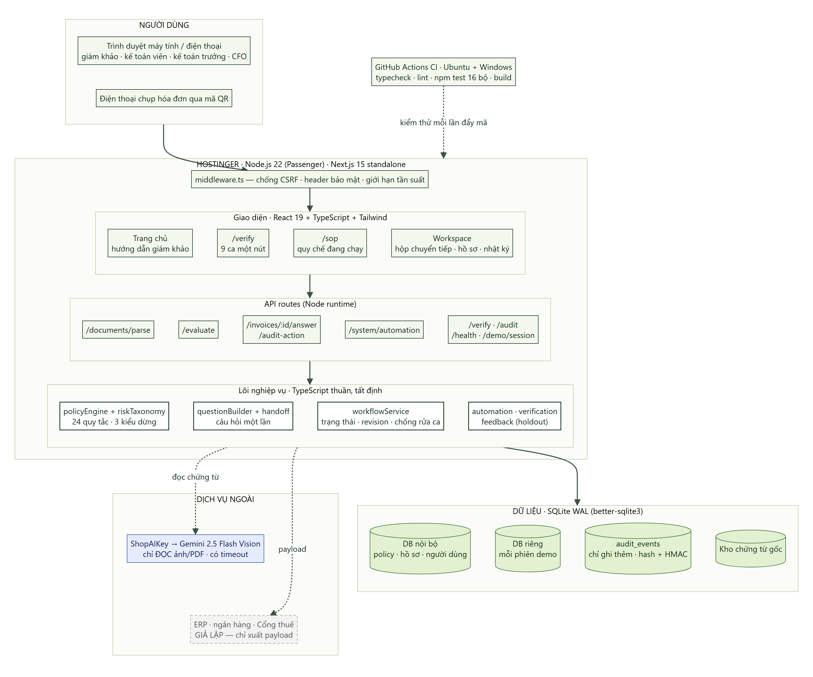
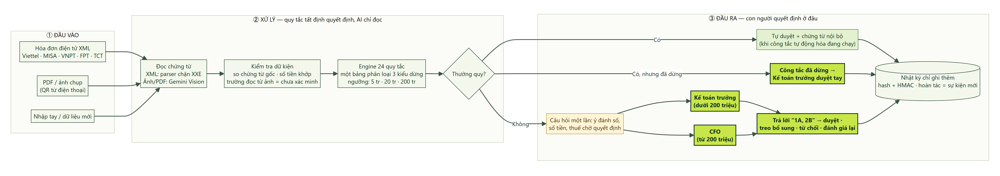
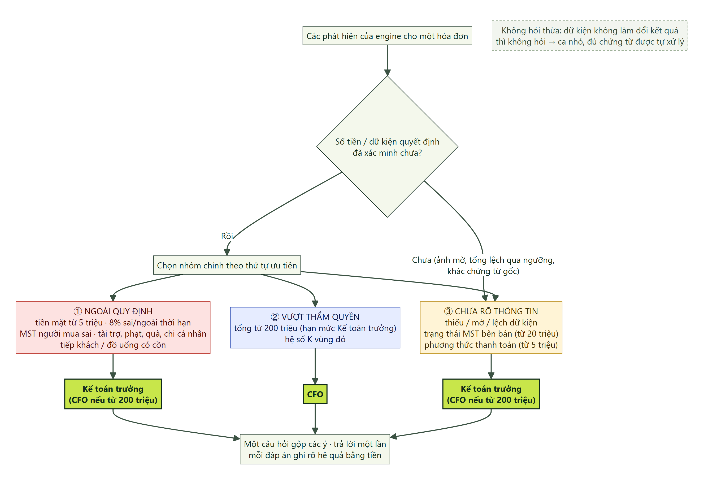
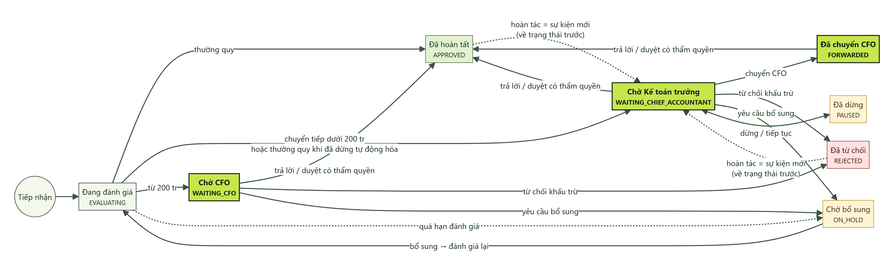
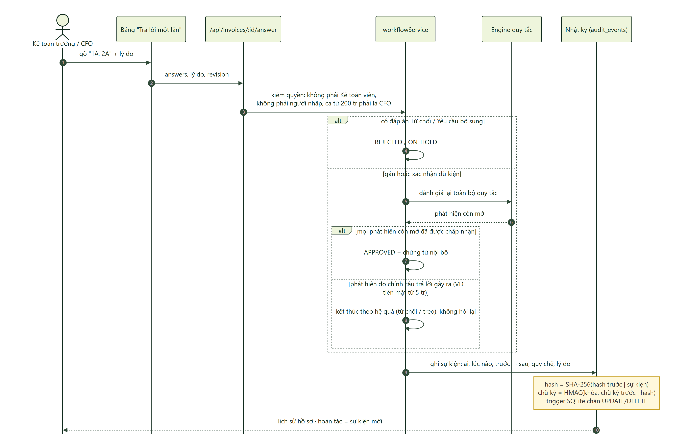

# HỒ SƠ KỸ THUẬT & NGHIÊN CỨU · Tax Referee

**Đội Fprinciples · MLAI Hackathon 2026 · Track VNG · Đề A "The Escalation Referee" · Cập nhật 15/10/2026**

Mã nguồn: https://github.com/khanhle1406/Tax-Referee · Live: https://limegreen-salamander-517622.hostingersite.com · Phiên bản đang chạy: `/api/health`

Mỗi khẳng định trong tài liệu kèm đường dẫn mã nguồn hoặc bằng chứng trong repo. Số liệu kiểm thử là **dữ liệu tổng hợp**, chưa phải đánh giá độc lập.

---

## 1. Nguyên tắc kiến trúc

| Nguyên tắc | Cách hiện thực | Mã nguồn |
|---|---|---|
| AI chỉ đọc, quy tắc quyết định | Mọi kết quả mang `decisionAuthority: 'LOCAL_POLICY_ENGINE'`. Gemini chỉ trích xuất trường và tìm trích dẫn khi tra cứu MST. Câu hỏi sinh từ template tất định; AI diễn đạt lại mặc định tắt (chỉ bật khi `QGEN_AI=1`, timeout 3,5 giây, phải qua guard) | `services/jevService.ts`, `services/questionBuilder.ts`, `services/questionGuard.ts` |
| Không vòng lặp agent | Mỗi revision chạy quy tắc đúng một lần; lease 60–300 giây (mặc định 120); quá hạn → `ON_HOLD`; kết quả về trễ bị hàng rào revision/attempt loại | `services/workflowService.ts` |
| Mỗi chuyển trạng thái là một giao dịch | Giao dịch SQLite kèm sự kiện audit ghi vào hai chuỗi hash | `services/workflowService.ts`, `lib/server/audit.ts` |
| Cô lập dữ liệu | Mỗi phiên demo một file SQLite; Verify chạy từng ca trên database `:memory:` riêng, không gọi AI | `lib/server/db.ts`, `services/refereeEvaluationService.ts` |

## 2. Kiến trúc tổng thể

Hình 3. Kiến trúc hệ thống

Hệ thống gồm sáu lớp:

1. **Máy khách:** trình duyệt hoặc điện thoại (QR), gọi qua HTTPS.
2. **Biên:** `middleware.ts` kiểm tra CSRF cho mọi yêu cầu ghi vào `/api` (trừ webhook).
3. **Route handler** (`app/api/**`): `documents/parse`, `invoices/evaluate`, `invoices/[id]/answer`, `invoices/[id]/audit-action`, `system/automation`, `verify`, `demo/session`, `health`.
4. **Dịch vụ miền:** tiếp nhận chứng từ, policy engine, câu hỏi chuyển tiếp, workflow, audit, công tắc tự động hóa, tự điều chỉnh ngưỡng, cập nhật pháp lý.
5. **Lưu trữ:** `runtime/tax-referee.sqlite` (WAL), `runtime/demo/<uuid>.sqlite`, `runtime/artifacts/`.
6. **Dịch vụ ngoài:** ShopAIKey → Gemini 2.5 Flash (đọc ảnh/PDF scan; tra cứu MST, chỉ nhận nguồn `*.gov.vn`).

## 3. Luồng xử lý một hóa đơn

Hình 1. Luồng xử lý hóa đơn

**Tiếp nhận** (`POST /api/documents/parse`):

1. Kiểm tra đăng nhập (401), kích thước tối đa 15MB (413), loại file XML/PDF/PNG/JPG/WEBP (415).
2. Băm SHA-256 nội dung. Cùng hash đã có kết quả thì trả lại từ cache; chưa có thì lưu artifact.
3. Rẽ nhánh theo loại file:
   - **XML:** từ chối DOCTYPE/ENTITY, chạy XMLValidator rồi parse bằng fast-xml-parser.
   - **PDF:** PyMuPDF (dự phòng pypdf) đọc được từ 50 ký tự thì phân tích văn bản; PDF scan thì gửi Gemini Vision.
   - **Ảnh:** sharp sàng lọc (REJECT → 422), nén rồi gửi Gemini Vision. AI kết luận không phải hóa đơn thì dừng.
4. Làm sạch, đối chiếu MST với nguồn `.gov.vn`, kiểm chữ số MST, kiểm số học. Ghi bằng chứng từng trường vào `extraction_reviews`: nguồn (XML, PDF_TEXT, VLM, OFFICIAL_REGISTRY, INFERRED) và trạng thái (VERIFIED, UNCERTAIN, CONFLICT, ABSENT).

**Đánh giá** (`POST /api/invoices/evaluate` → `evaluateWorkflow`):

5. Chuẩn hóa giá trị nhập. Thuế suất ngoài các mức 0/5/8/10% được coi là dữ kiện chưa xác minh.
6. Từ chối (409) nếu hồ sơ đang `PAUSED`/`EVALUATING`, hoặc chứng từ nguồn không khớp hash.
7. Tính tập dữ kiện bắt buộc theo ngưỡng; so 15 trường với chứng từ gốc. Trường bị sửa sau khi hồ sơ đã chuyển tiếp phải được KTT/CFO xác nhận (chống "rửa ca").
8. Hash {hóa đơn, review} trùng bản đã quyết thì trả kết quả cũ; `expectedRevision` lệch thì 409.
9. Mở giao dịch: `EVALUATING`, revision + 1, attempt id, lease, snapshot policy, ghi `invoice_revisions` và audit `EVALUATION_STARTED`.
10. `evaluateInvoiceLocally` chạy quy tắc. Không có phát hiện → ROUTINE. Có phát hiện → ESCALATED, thuế khấu trừ bằng 0. Còn dữ kiện chưa xác minh thì thêm câu hỏi theo trường và phát hiện `RULE_SOURCE_REVIEW`.
11. ESCALATED: `buildHandoff` dựng câu hỏi, `checkHandoff` kiểm tra; không đạt → `ON_HOLD`.
12. Zod kiểm quyết định; commit chỉ khi hàng rào (revision, status, attemptId) khớp. Trạng thái đích:
    - ROUTINE, công tắc bật → `APPROVED`, chứng từ nội bộ `READY_TO_POST`, audit `ROUTINE_AUTO_APPROVED`;
    - ROUTINE, công tắc dừng → `WAITING_CHIEF_ACCOUNTANT`, audit `ROUTINE_HELD_AUTOMATION_PAUSED`;
    - ESCALATED → `WAITING_CFO` hoặc `WAITING_CHIEF_ACCOUNTANT`;
    - ngoại lệ → `ON_HOLD`, audit `EVALUATION_FAILED`.

## 4. Ba kiểu dừng và chọn người nhận

Hình 2. Ba kiểu dừng và người nhận

- **Một bảng phân loại** `RULE_CATALOG` (`lib/riskTaxonomy.ts`) có 25 mục: 24 quy tắc của hợp đồng quy tắc (23 do policy engine kiểm, cộng `RULE_SOURCE_REVIEW` do workflow thêm) và mục dự phòng `RULE_SOURCE_CONFLICT` (hiện chưa có mã phát sinh). Phân bổ: 13 Chưa rõ thông tin, 10 Ngoài quy định, 2 Vượt thẩm quyền. SOP, engine và workflow cùng tra bảng này.
- **Nhóm chính** theo thứ tự `OUT_OF_POLICY > EXCEED_AUTHORITY > UNCERTAIN_INFO`. Phát hiện dựa trên dữ kiện chưa xác minh (`triggerFields` còn nghi vấn) luôn xếp cuối.
- **Người nhận:** `requiresCFO` khi tổng tiền từ hạn mức KTT (mặc định 200 triệu), có phát hiện loại AUTHORITY, hoặc nhà cung cấp nằm trong danh bạ cảnh báo (`RULE_HIGH_RISK_SUPPLIER`); còn lại gửi KTT.
- **Ngưỡng trọng yếu** (`lib/refereeRequirements.ts`): hỏi hình thức thanh toán khi tổng tiền (gộp cùng bên bán trong ngày) đạt ngưỡng không dùng tiền mặt; hỏi trạng thái MST bên bán từ 20 triệu; đòi bảng kê với hóa đơn tư vấn, tiếp khách, ăn uống, hội nghị, dịch vụ tổng hợp thiếu chi tiết dòng.
- **Số tiền chưa chắc** (`unverifiedAmountFacts`): khi ảnh mờ, hoặc khi tổng in và (tiền hàng + thuế) nằm hai phía hạn mức KTT hay ngưỡng tiền mặt. Khi đó hệ thống hỏi số đúng trước khi kết luận.
- **`humanAcceptable`** quyết định phát hiện nào người có thẩm quyền được chấp nhận. Phát hiện về dữ liệu (trừ ngày ký lệch và hóa đơn lập trước ngày bên bán đóng MST), tiền mặt, thuế suất, hóa đơn trùng, MST người mua phải sửa bằng chứng rồi đánh giá lại.
- **Tiền lệ CFO** chỉ giải tỏa phát hiện `INTERNAL_POLICY`, đúng bên bán, mục đích, hạn mức, thời hạn.

## 5. Máy trạng thái hồ sơ

Hình 4. Máy trạng thái hồ sơ

Trạng thái chính: `EVALUATING`, `APPROVED`, `WAITING_CHIEF_ACCOUNTANT`, `WAITING_CFO`, `FORWARDED`, `REJECTED`, `ON_HOLD`, `PAUSED`. `RECEIVED` chỉ là nhãn snapshot ban đầu. Mọi chuyển trạng thái đều tăng revision, đồng bộ chứng từ nội bộ, tính lại hệ số K và ghi audit.

Các chuyển dịch phụ:

- **PAUSE:** từ mọi trạng thái (trừ `PAUSED`), lưu `paused_from`, đặt thuế duyệt về 0; kết quả đánh giá về trễ bị loại.
- **RESUME:** về `paused_from` nếu đó là `WAITING_*`/`FORWARDED` và đã có quyết định; trường hợp khác về `ON_HOLD`.
- **TAX_HOLD / RELEASE_TAX_HOLD:** về `ON_HOLD`, phải đánh giá lại.
- **UNDO:** về trạng thái trước của sự kiện gần nhất còn đảo ngược được; tiền lệ sinh từ sự kiện đó bị thu hồi; hoàn tác là sự kiện mới `INVOICE_ACTION_REVERTED`.

**Điều kiện duyệt (`approvalBlock`):** người duyệt không phải kế toán viên và không phải người nhập; hồ sơ không ở `PAUSED`/`EVALUATING` và đã có evaluation; ca cần CFO hoặc đã `FORWARDED` chỉ CFO được duyệt; không còn cờ đánh giá lại, dữ kiện chưa xác minh hay giữ thuế; mọi phát hiện mở đều `humanAcceptable` và nằm trong `resolvedFindingIds`.

## 6. Luồng trả lời "1A, 2B" và nhật ký kiểm toán

Hình 5. Trả lời "1A, 2B" và nhật ký kiểm toán

**Trả lời** (`POST /api/invoices/[id]/answer` → `answerHandoff`). Đầu vào gồm `answers` (VD `{"1":"A","2":"B"}`), `values` khi cần, lý do (tối thiểu 8 ký tự), `revision`, `evaluationId`.

1. **Chốt chặn:** không phải kế toán viên (403); revision và evaluation là bản hiện hành (409); trạng thái chờ và quyết định là ESCALATED; ca CFO thì người trả lời phải là CFO; không phải người nhập; mọi ý đều đã trả lời.
2. **Kiểm tra trước khi ghi:** hệ quả `NEED_VALUE` bắt buộc có giá trị; thiếu thì trả 400 mà không để lại dấu vết "đã trả lời".
3. **Thứ tự áp dụng:** có `REJECT` → `REJECTED`; có `REQUEST_INFO` → `ON_HOLD`; có `SET_FIELDS`/`CONFIRM_FIELDS`/`NEED_VALUE` → đánh giá lại bằng engine cục bộ. Nếu còn phát hiện do chính trường vừa trả lời gây ra và không được chấp nhận thì kết thúc ở `REJECTED` (Ngoài quy định) hoặc `ON_HOLD`, không hỏi lại. Còn phát hiện khác thì hồ sơ nhận câu hỏi mới cho phát hiện đó. Chỉ có `RESOLVE` → `APPROVED`, vẫn qua `approvalBlock`.
4. Ghi `HANDOFF_ANSWERED` gồm câu trả lời, đáp án, lý do, kết quả, trạng thái đích và các quy tắc gây hệ quả.

**Chuỗi audit** (`lib/server/audit.ts`):

- `eventHash = SHA256(prevHash | eventType | entityId | actorId | payloadJson | createdAt)`.
- Khi đặt `TAX_REFEREE_AUDIT_KEY` (từ 32 ký tự, nằm ngoài database): `eventMac = HMAC-SHA256(key, prevMac | eventHash)`.
- `recordAction` ghi đồng thời vào `audit_events` và `immutable_audit_trail`. Payload gồm evaluationId, revision, phiên bản và hash policy, người thao tác, snapshot trước/sau, lý do, `inputHash`, phiên bản contract, commit.
- Trigger SQLite `BEFORE UPDATE/DELETE → RAISE(ABORT)` trên hai bảng audit (migration 20); `audit_chain_checkpoints` chặn cả chèn, sửa, xóa (migration 21).
- `verifyAuditChain` phát hiện hash sai, chữ ký bị xóa sau khi đã bật khóa, HMAC không khớp (chuỗi bị tính lại) và mốc giả.
- `/api/health` công bố `audit.events`, `audit.headHash`, `audit.hmac`.

## 7. Bảng công nghệ

| Tầng | Công nghệ (theo `package.json`) | Vai trò | Thật / giả lập |
|---|---|---|---|
| Ứng dụng | Next.js 15.5.27, React ^19.0.0, TypeScript ^5.8.2, Node ≥ 20.19 | Trang và API route handler | Thật |
| Giao diện | Tailwind CSS ^3.4.17, Radix UI, lucide-react, sonner | 10 thành phần kiểu shadcn/ui | Thật |
| Kiểm tra dữ liệu | Zod ^3.24.2 | Schema hóa đơn, quyết định, câu trả lời | Thật |
| Lưu trữ | better-sqlite3 12.11.1, WAL, foreign keys | Database nội bộ, demo, Verify | Thật |
| XML | fast-xml-parser ^5.11.2 | Parse hóa đơn điện tử, chặn XXE | Thật |
| PDF có chữ | PyMuPDF, dự phòng pypdf (`lib/server/pdfToImage.ts`) | Đọc text, không gọi AI | Thật |
| Ảnh | sharp ^0.35.5 (`services/invoiceImagePreflight.ts`) | Sàng lọc và nén ảnh | Thật |
| Đọc ảnh/PDF scan | Gemini 2.5 Flash qua ShopAIKey, JSON, temperature 0, timeout 35 giây | Trích xuất trường | Thật khi có khóa |
| Tra cứu MST | Google Search grounding qua ShopAIKey, chỉ nhận `*.gov.vn` | Chỉ tự điền khi `VERIFIED` | Thật khi có khóa |
| Qwen/OpenRouter, OCR cục bộ | `qwenService`, `localOcrService`, `receiptOcrService` | Chỉ dùng trong script benchmark và kiểm thử | Không nằm trên route live |
| Xác thực | bcryptjs ^3.0.3; cookie httpOnly, SameSite=Lax, Secure (production), hạn 8 giờ | Ba vai trò | MVP; vai trò demo là mô phỏng |
| Kiểm thử | node:test + tsx ^4.23.15, `scripts/qa/run-all.ts` | 16 bộ | Thật |
| CI | GitHub Actions | Ubuntu + Windows, Node 22 | Thật |
| Triển khai | Hostinger Node.js (Passenger, 1 instance), Next standalone | Phát hành theo release | Thật |
| Mở rộng (beta) | Ngân hàng, đối soát TCT, ERP, báo cáo thuế | Ngoài phạm vi Đề A | Một phần giả lập / chỉ xuất payload |

## 8. Bảo mật

- **CSRF:** `middleware.ts` kiểm tra `Sec-Fetch-Site` (dự phòng: so Origin với Host) cho mọi POST/PUT/PATCH/DELETE vào `/api`, trừ webhook.
- **XXE:** từ chối `DOCTYPE`/`ENTITY` trước khi parse (`lib/documentParser.ts`).
- **Giới hạn tần suất:** tạo phiên demo tối đa 30 lần/giờ mỗi IP; tra cứu MST tối đa 60 lần/giờ mỗi người dùng; toàn hệ thống tối đa 2.000 phiên demo (`lib/server/rateLimit.ts`, `app/api/demo/session/route.ts`).
- **Hiển thị chứng từ:** `nosniff`, CSP có `default-src 'none'` và `sandbox` cho mọi loại trừ PDF; header toàn cục `X-Frame-Options: SAMEORIGIN`, `Referrer-Policy: same-origin` (`next.config.ts`).
- **Quota lưu trữ:** mỗi phiên demo 100 file/100MB; database nội bộ 10.000 file/1GB (`lib/server/artifactQuota.ts`).
- **Webhook pháp lý:** secret từ 24 ký tự, so bằng `timingSafeEqual`.
- **Bí mật:** `.env` nằm ngoài thư mục release (chmod 600); khóa HMAC không lưu trong database.

## 9. Kiểm thử và CI

- **`npm test`:** 16 bộ gồm 44 unit test (10 file trong `tests/unit/`) và 15 bộ hồi quy, trong đó có 72 ca red team. Mỗi bộ chạy trong tiến trình riêng với thư mục dữ liệu tạm; các bộ có đường gọi AI dùng khóa giả, và CI không có khóa AI thật. Bộ nào in ít dòng PASS hơn ngưỡng `minChecks` bị tính là FAIL.
- **CI** (`.github/workflows/ci.yml`): ma trận ubuntu-latest và windows-latest chạy typecheck, typecheck:referee, lint, test; job build chạy sau khi test đạt.
- **Smoke HTTP** (`scripts/qa/test-api-smoke.ts`, `TEST_BASE_URL`): cô lập giữa hai phiên demo, lỗi 409 khi gửi revision cũ, hoàn tác, đọc chứng từ.
- **Phục hồi:** `npm run test:recovery` kiểm tra dữ liệu còn nguyên sau khởi động lại.
- **Playwright** (ngoài repo): 18/19 mục trên bản build, máy tính và điện thoại 390px; mục còn lại là phản hồi 401 đúng thiết kế.

## 10. Vận hành và triển khai

1. Passenger (1 instance) chạy `hbuilds/current` (symlink tới release đang dùng). `deployment/hostinger-bootstrap.cjs` đọc `hbuilds/config/.env`, đặt `TAX_REFEREE_DATA_DIR=runtime`, thêm Python 3.11 và `runtime/python` (PyMuPDF, Pillow, pypdf), rồi khởi động Next standalone.
2. Phát hành: trên máy local `npm ci` → typecheck → `npm test` → build; `pack-hostinger.py` đóng gói (loại `node_modules`, `.env`, dữ liệu runtime; ghi `.git-commit`); `scp` lên host, tạo release mới, `npm ci` trên Linux; đổi symlink, touch `tmp/restart.txt`.
3. Kiểm tra sau phát hành: `curl /api/health` (commit, policy hash, contract, head hash) và `TEST_BASE_URL=… npm run test:api`.
4. Rollback: trỏ symlink về release trước.
5. Backup: SQLite backup API kèm thư mục artifacts (`deployment/HOSTINGER.md`); `scripts/ops/cleanup-demo.py` dọn phiên demo cũ.

## 11. Nghiên cứu pháp lý

| Nhóm quy tắc | Văn bản dẫn chiếu | Mức xác minh |
|---|---|---|
| Thanh toán không dùng tiền mặt (5 triệu từ 01/07/2025; 20 triệu trước đó theo TT 219/2013/TT-BTC); gộp mua cùng bên bán trong ngày | Luật 48/2024/QH15; NĐ 181/2025/NĐ-CP | DOCUMENT_CONFIRMED_RULE_PENDING (hóa đơn từ 01/07/2025) |
| Thuế suất 8% cho hàng thuộc danh mục loại trừ, hoặc hóa đơn lập ngoài thời gian giảm thuế (sau 31/12/2026 hoặc trước 01/02/2022) | NQ 204/2025/QH15; NĐ 174/2025/NĐ-CP | DOCUMENT_CONFIRMED_RULE_PENDING |
| Hóa đơn lập sau ngày bên bán đóng MST; sai MST người mua | NĐ 70/2025/NĐ-CP; NĐ 254/2026/NĐ-CP (theo ghi nhận trong repo), chọn theo ngày lập | DOCUMENT_CONFIRMED_RULE_PENDING (hóa đơn từ 01/06/2025) |
| Ký hiệu, mã CQT, ngày ký, hóa đơn điều chỉnh | NĐ 123/2020/NĐ-CP; TT 78/2021/TT-BTC (căn cứ engine ghi); nguồn đối chiếu của hợp đồng: NĐ 70/2025/NĐ-CP, NĐ 254/2026/NĐ-CP | DOCUMENT_CONFIRMED_RULE_PENDING (hóa đơn từ 01/06/2025) / UNVERIFIED (trước đó) |
| Hóa đơn trùng; nhà cung cấp có cảnh báo | Kiểm soát nội bộ | INTERNAL_POLICY / UNVERIFIED |
| Tiếp khách, chi ngoài phạm vi; hạn mức KTT; hệ số K | SOP mẫu Điều 2.1, 2.3, 3.3, 4.3 | INTERNAL_POLICY |

`DOCUMENT_CONFIRMED_RULE_PENDING` chỉ xác nhận văn bản tồn tại và ngày hiệu lực, chưa xác nhận diễn giải điều khoản. Ba điểm cần chuyên gia thuế chốt:

1. Engine ghi căn cứ ngưỡng 5 triệu là "Khoản 2 Điều 14 Luật 48/2024/QH15", trong khi nguồn đối chiếu của hợp đồng quy tắc là NĐ 181/2025/NĐ-CP.
2. Danh mục loại trừ 8% được nhận diện bằng từ khóa tên hàng; registry ghi dịch vụ CNTT "không mặc nhiên bị loại khỏi 8%" nhưng danh sách từ khóa có CNTT và phần mềm. Vì vậy quy tắc chỉ chuyển tiếp để đối chiếu.
3. Hệ số K được registry gắn với CV 2392/TCT-QLRR nhưng hợp đồng quy tắc xếp là ngưỡng nội bộ.

Văn bản mới từ nguồn cập nhật chỉ thành ứng viên `NEEDS_REVIEW`, cần người duyệt và được ghi audit (`services/legal/legalUpdateService.ts`).

## 12. Phương pháp đánh giá

| Lớp | Thiết kế | Kết quả | Giới hạn |
|---|---|---|---|
| Diễn tập 11 ca | 3 thường quy + 8 chuyển tiếp (3/4/1); nhãn viết trước; cùng script trên commit `33522a0` và bản cải tiến (nhánh `feat/track-a-hardening`, 14/10); database tạm; không gọi AI | Xử lý đúng 3/11 → 11/11; chuyển tiếp thừa 3/3 → 0/3; sai nhóm 4/8 → 0/8; câu hỏi cụ thể 1/10 → 8/8 | Tập phát triển do đội viết |
| Red team 72 ca | 6 trợ lý AI viết từ tài liệu quy định, không đọc mã engine; 21 thường quy, 51 chuyển tiếp (19/25/7) | 66/72 → 72/72, nay là bộ hồi quy | Nhãn do AI gán, chưa được người nghiệp vụ duyệt |
| Verify live | 4 ca chung + 5 ca Đề A, từng ca trên `:memory:` | 9/9, 268 ms, 15/10/2026 | Ca công khai |
| Tự điều chỉnh ngưỡng | ≥ 10 nhãn hậu kiểm; holdout 30% mới nhất theo thời gian; Wilson 95%; 4 ca đối kháng trong savepoint; phiên bản, audit, CFO khôi phục | Cơ chế đã có kiểm thử (`tests/unit/thresholdHoldout.test.ts`) | Chưa có nhãn thật |
| Người dùng (16/10) | 3 người ghi quyết định cho 5 ca trước khi xem kết quả; 20 câu hỏi; `scripts/qa/evaluate-user-study.ts` tính đồng thuận, bỏ sót, chuyển tiếp thừa kèm Wilson | Có ngày 16/10 | 5 ca: khoảng tin cậy rộng |
| Đánh giá độc lập | Khóa nhãn SHA-256 (`npm run labels:lock`), chấm `npm run evaluate:independent`; mục tiêu 40 ca, tối thiểu 20 | Chưa công bố | Cần hóa đơn thật có cho phép |

## 13. Truy vết mã nguồn

| Thành phần | Đường dẫn |
|---|---|
| Tiếp nhận chứng từ | `app/api/documents/parse/route.ts`, `lib/documentParser.ts`, `services/invoiceImagePreflight.ts`, `lib/server/pdfToImage.ts` |
| Đọc ảnh bằng AI | `services/geminiService.ts` |
| Xác minh nhà cung cấp | `services/officialSupplierLookupService.ts`, `services/duplicateDetector.ts` |
| Hợp đồng quy tắc và SOP | `data/policyContract.ts`, `data/sopText.ts`, `data/regulatoryRegistry.ts`, `lib/constants.ts` |
| Engine và phân loại | `services/policyEngine.ts`, `lib/riskTaxonomy.ts`, `lib/refereeRequirements.ts` |
| Câu hỏi chuyển tiếp | `services/questionBuilder.ts`, `services/handoffService.ts`, `services/questionGuard.ts` |
| Workflow và trả lời | `services/workflowService.ts`, `app/api/invoices/[id]/answer/route.ts`, `components/HandoffAnswerPanel.tsx` |
| Công tắc và hoàn tác | `services/automationControl.ts`, `app/api/system/automation/route.ts`, `app/api/invoices/[id]/audit-action/route.ts` |
| Audit | `lib/server/audit.ts`, `lib/server/db.ts` |
| Tự điều chỉnh ngưỡng | `services/feedbackService.ts` |
| Cập nhật pháp lý | `services/legal/*`, `app/api/webhooks/legal-update/route.ts` |
| Verify | `app/api/verify/route.ts`, `services/verificationService.ts`, `services/refereeEvaluationService.ts`, `data/verification/*` |
| Bảo mật | `middleware.ts`, `lib/server/auth.ts`, `lib/server/rateLimit.ts`, `lib/server/artifactQuota.ts`, `next.config.ts` |
| Kiểm thử và CI | `scripts/qa/run-all.ts`, `tests/unit/*`, `.github/workflows/ci.yml` |
| Triển khai | `deployment/HOSTINGER.md`, `deployment/hostinger-bootstrap.cjs`, `RUNBOOK.md` |

## 14. Giới hạn kiến trúc đã biết

- SQLite chạy một instance; bộ giới hạn tần suất nằm trong bộ nhớ của một tiến trình.
- Ảnh hóa đơn được gửi tới dịch vụ AI bên thứ ba qua proxy; XML không qua AI.
- Đọc ảnh mất nhiều giây (đo 15/10: ảnh ~14 giây, PDF scan ~26 giây).
- Chuỗi audit chỉ chống được việc tính lại toàn bộ chuỗi khi đã đặt `TAX_REFEREE_AUDIT_KEY`.
- "Ngoài phạm vi SOP" nhận diện bằng từ khóa; hóa đơn tách nhỏ chưa cộng dồn khi xét hạn mức CFO; ngày lập ở tương lai gần chưa bị chặn.
